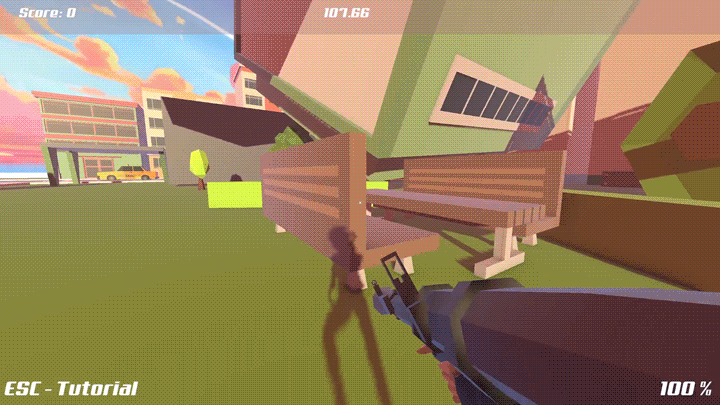
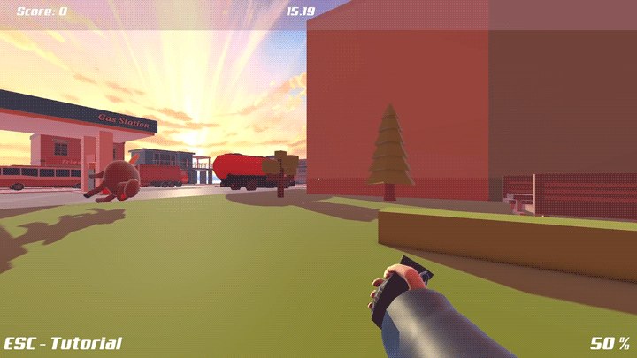
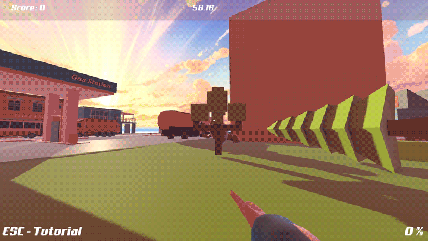

# Semester Project Virtual and Augmented Reality

## Overview
For my Virtual and Augmented Reality class at the University of Luxembourg (May 2025) the assignment was to create an experience in Unity.
I worked solo and made a small video game that requires the player to use and manipulate physics. **Note: The project was not required to be VR/AR. This game is not a VR/AR game.**

The player has various tools to push, pull, freeze, enlarge and shrink every object in the world. The goal is to build a path to the top to reach a star. Each time you reach one it moves to a new random spot. Collect 3 stars to finish the game, a timer keeps track of how long it took you.

## Game
### Full-Body Avatar & First Person
The player controls a full body avatar in first person.
- Blender was used to make the faces transparent but still cast shadows. With this the camera could be placed inside the head to implement an immersive first person view.
- The avatar plays animations using the animation blend tree. Based on the movement vector the avatar will play a walking animation that is going in the appropriate direction with a falling animation always taking priority if the vector is going up or down due to jumping or falling.
- IK was used to make the right arm and hand always aim towards the middle of the screen so that it feels like the finger gun and rocket launcher are always being pointed towards where you actually want to shoot.

### Physics Manipulation Gameplay
Player interactions come from either shooting raycasts from the player or throwing projectiles to the center of the screen. Projectiles when detonating create an overlap sphere that detects all rigidbodies it is overlapping with.
- When detecting collision depending on the weapon being used a force will be applied either pointing away from the raycast or sphere, or towards the sphere. In the case of the raycast the force is applied on the collision point and for the sphere the force is applied from the center of the sphere.

All the interactable GameObjects are rigidbodies, initially their position and rotation are frozen so that they are stable but if the player interacts with them through the physics manipulation their position and rotations are unfrozen. The player is able to freeze any object's position and rotation again.

## Controls
1. Finger gun:
   - Left Click: Slightly push an object.

2. Grenade:
   - Left Click: Throw a grenade that upon explosion pulls everything around it.

   

3. Rocket Launcher:
   - Left Click: Shoot a rocket that explodes and pushes everything around it with great force.

4. Right Click:
   - Freeze any object in its current position and rotation. Right Click it again to unfreeze it. **Will unfreeze if any force is applied to it.**

5. Mousewheel Scroll Up/Down:
   - Enlarge or shrink any object that the player is currently aiming at.
   **Enlarging increases energy while shrinking decreases it. Energy starts at 50% and stays between 0% and 100%.**

   

6. Press number key 1-3 to change weapon:
   - #1 for Finger gun
   - #2 for Grenade
   - #3 for Rocket Launcher

7. WASD, Space and Left Shift:
   - Move, jump and sprint. Walk into an object while holding W to climb it.

8. Esc:
   - Pause the game and show the tutorial.

## Tech Stack
Built with Unity 6000.1.1f1 and C#, using the Universal Render Pipeline (URP) and the Animation Rigging package for the IK.

My own scripts are in `Assets/Scripts/Code`. The player is based on the Modular First Person Controller from the Asset Store (see Credits). I extended its script `Assets/ModularFirstPersonController/FirstPersonController/FirstPersonController.cs` with the weapons, freezing, resizing, wall climbing and animations.

## Setup & Running
A [release](https://github.com/raigeki49/Semester-Project-Virtual-and-Augmented-Reality/releases) is provided for you to download and play.

Otherwise you can import this repo into Unity 6000.1.1f1 (recommended for guaranteed compatibility) and build the project yourself. The game scene is `Assets/Level/Scenes/Main.unity`.

## Status
This project is completed and earned a grade of 19.10/20(scale of 20).

## Credits
Skybox: https://freestylized.com/skybox/sky_38/

Grass Texture: https://opengameart.org/content/awesome-seamless-grass-texture

Music: https://www.youtube.com/@racksbtw

Physics Debug Extension: https://assetstore.unity.com/packages/tools/physics/physics-debug-extension-88947

Star: https://assetstore.unity.com/packages/3d/props/simple-collectibles-pack-123092

Models in the city from: https://assetstore.unity.com/packages/3d/environments/simplepoly-town-pack-62400
https://assetstore.unity.com/packages/3d/environments/urban/free-low-poly-simple-urban-city-3d-asset-pack-239474
https://assetstore.unity.com/packages/3d/environments/landscapes/lowpoly-environment-pack-99479
https://assetstore.unity.com/packages/3d/environments/simplepoly-city-low-poly-assets-58899

Water: https://assetstore.unity.com/packages/vfx/shaders/water-stylized-shader-orto-perspective-camera-297566

RPG: https://assetstore.unity.com/packages/3d/props/guns/low-poly-weapons-vol-1-151980

Explosion VFX: https://assetstore.unity.com/packages/vfx/particles/particle-pack-127325

Explosion Sounds: https://assetstore.unity.com/packages/audio/sound-fx/grenade-sound-fx-147490

Grenade Model: https://assetstore.unity.com/packages/3d/props/grenades-lowpoly-120047

Player Character Prefab + Script: https://assetstore.unity.com/packages/3d/characters/modular-first-person-controller-189884

Animations: https://www.mixamo.com/

Character Model: https://monster-black.itch.io/character-boy-2-fbx

## License
My own code is licensed under MIT, see [LICENSE](LICENSE). Third-party assets listed under Credits keep their own licenses.

If you own any of the assets or content used in this project and have a problem with it being here, please contact me by opening an issue on this repository and I will remove it.
